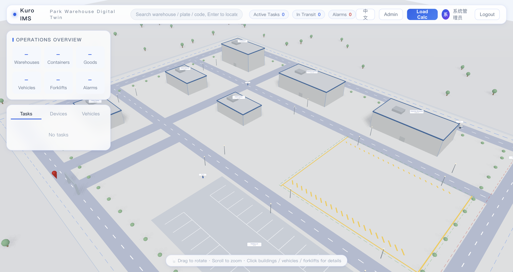
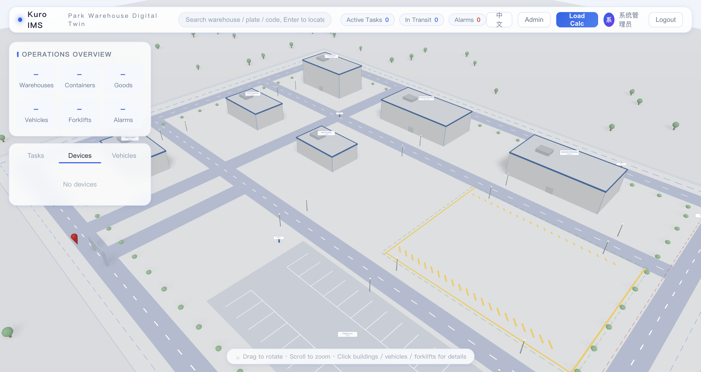
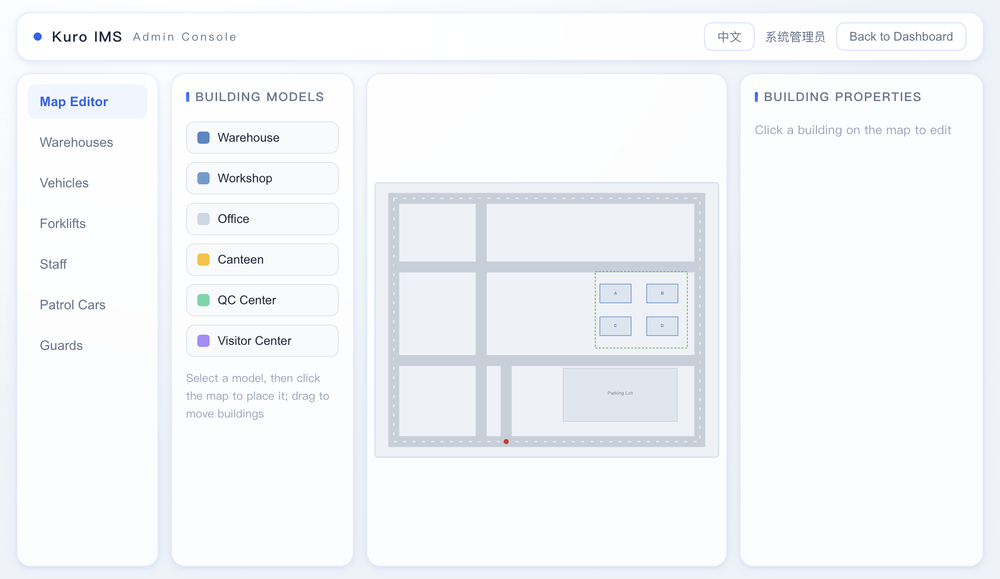
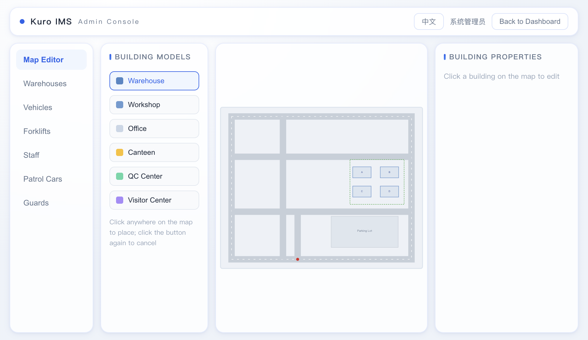
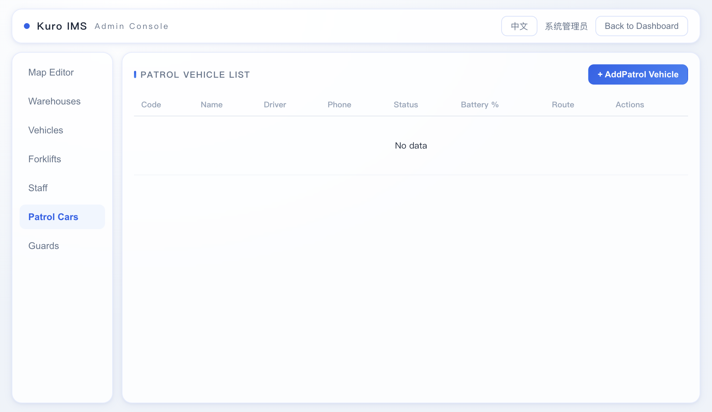
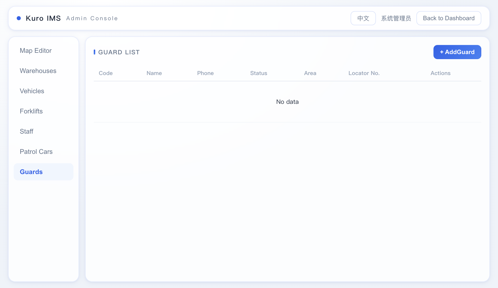

# Kuro IMS · 智能车间监控系统

> 基于 **Vue 3 + Spring Boot + Three.js + MySQL** 的 3D 仓储园区可视化平台。
> 借鉴策略游戏地图交互：在 3D 园区中点击仓库查看运营、点击货车追踪运输、点击叉车/托盘查看任务与货物，空间位置与业务数据同屏关联。

---

# Kuro IMS · Intelligent Warehouse Management System

> A 3D warehouse park visualization platform built with **Vue 3 + Spring Boot + Three.js + MySQL**.
> Inspired by strategy game map interactions: click warehouses to view operations, click trucks to track shipments, click forklifts/pallets to view tasks and cargo. Spatial positions and business data are linked on the same screen.

---

## 技术栈 | Tech Stack

| 层 Layer | 技术 Technology |
|---|---|
| 前端 Frontend | Vue 3 · Vite · Pinia · Vue Router · Three.js · Axios |
| 后端 Backend | Spring Boot 3 · Spring Security · MyBatis-Plus · JWT |
| 数据库 Database | MySQL 8 |

## 功能 | Features

- **用户体系 | User System**：注册 / 登录 / JWT 双 Token（Access 2h + Refresh 7d）/ 过期自动刷新
- **3D 园区 | 3D Park**：仓库、货车、叉车、货柜、托盘三维可视化，悬停高亮 + 点击查看业务详情，在途车辆/作业叉车实时动画
- **运营面板 | Operations Panel**：统计总览、任务列表、设备监控（OEE/温湿度）、车辆追踪
- **货柜计算 | Container Calculator**：支持 20GP/40GP/40HQ/45HQ 标准柜与自定义柜，按容积 + 载重计算装载率与未装入明细
- **统一视觉 | Unified Design**：透明毛玻璃主题，统一色板 / 字号 / 圆角体系

## 目录结构 | Project Structure

```
kuro-ims/
├── backend/                 # Spring Boot 后端 | Spring Boot Backend
│   └── src/main/
│       ├── java/com/kuro/ims/
│       │   ├── config/      # Security、MyBatis-Plus、CORS 配置 | Configurations
│       │   ├── controller/  # REST API（8 个资源 + 货柜计算 + 统计）| REST APIs
│       │   ├── dto/         # 请求/响应对象 | Request/Response DTOs
│       │   ├── entity/      # 8 张表实体 | Entity Classes
│       │   ├── filter/      # JWT 过滤器 | JWT Filter
│       │   ├── mapper/      # MyBatis-Plus Mapper | Data Access Layer
│       │   ├── service/     # 认证、货柜计算 | Business Services
│       │   └── utils/       # JwtUtils、UserContext | Utilities
│       └── resources/
│           ├── application.yml
│           └── sql/init.sql # 建库建表 + 演示数据 | DDL + Seed Data
└── frontend/                # Vue 3 前端 | Vue 3 Frontend
    └── src/
        ├── api/             # Axios 封装（自动刷新 Token）| API Client with Auto Token Refresh
        ├── components/      # Scene3D / SidePanel / DetailPanel / ContainerCalc
        ├── store/           # Pinia 认证状态 | Pinia Auth Store
        ├── styles/          # 全局毛玻璃主题 | Global Glassmorphism Theme
        └── views/           # 登录页 / 主驾驶舱 | Login / Dashboard
```

## 快速启动 | Quick Start

### 1. 初始化数据库 | Initialize Database

```bash
mysql -uroot -p<你的密码> < backend/src/main/resources/sql/init.sql
# mysql -uroot -p<your_password> < backend/src/main/resources/sql/init.sql
```

默认演示账号：**admin / 123456** | Default demo account: **admin / 123456**

### 2. 启动后端（端口 8080）| Start Backend (Port 8080)

```bash
cd backend
# 数据库密码不是 123456 时通过环境变量覆盖
# Override via env var if your MySQL password is not 123456
MYSQL_PASSWORD=你的密码 mvn spring-boot:run
# MYSQL_PASSWORD=your_password mvn spring-boot:run
```

### 3. 启动前端（端口 5173）| Start Frontend (Port 5173)

```bash
cd frontend
npm install
npm run dev
```

访问 http://localhost:5173 ，Vite 已配置 `/api` 代理到后端。
Visit http://localhost:5173 , Vite has configured `/api` proxy to backend.

## 配置项 | Configuration

| 配置 Config | 默认 Default | 说明 Description |
|---|---|---|
| `MYSQL_HOST` `MYSQL_PORT` `MYSQL_DB` | localhost 3306 kuro_ims | 数据库连接 | Database connection |
| `MYSQL_USER` `MYSQL_PASSWORD` | root 123456 | 数据库账号 | Database credentials |
| `jwt.secret` | 内置开发密钥 | 生产环境务必覆盖 | Built-in dev key, override in production |
| `jwt.expire` | 7200000 | Access Token 有效期（2h）| Access Token TTL (2h) |
| `jwt.refresh-expire` | 604800000 | Refresh Token 有效期（7d）| Refresh Token TTL (7d) |

## API 概览 | API Overview

- `POST /api/auth/login` `POST /api/auth/register` `POST /api/auth/refresh` `GET /api/auth/profile`
- `GET|POST|PUT|DELETE /api/warehouses` （containers / goods / vehicles / forklifts / tasks / devices 同构 | same pattern）
- `POST /api/containers/calculate` 货柜装载计算 | Container loading calculation
- `GET /api/stats/overview` 运营总览统计 | Operations overview statistics

## 截图 | Screenshots

### 3D 园区主视图 | 3D Park Overview

实时渲染的等距斜 45° 鸟瞰园区，包含 4 座多跨连体钢结构仓库、行政办公楼、生产车间、巡逻车与巡检保安动态展示。



---

### 资产详情面板 | Asset Detail Panel

点击任意仓库/车辆/叉车，右侧弹出毛玻璃详情卡片，展示实时运营数据与状态。



---

### 后台管理 · 数据表格 | Admin · Data Tables

统一的 CRUD 后台，支持仓库、车辆、叉车、人员、巡逻车、保安等全量资产管理。



---

### 地图编辑器 | Map Editor

2D SVG 园区地图编辑器，支持拖拽放置建筑、编辑属性、实时同步到 3D 场景。



---

### 巡逻车管理 | Patrol Vehicle Management

园区巡逻车实时监控与调度，支持状态、电量、路线管理。



---

### 巡检保安管理 | Security Guard Management

巡检保安定位器追踪，实时展示巡检路线与负责区域。



---

### 核心亮点 | Key Highlights

- **真实内凹门洞**：仓库墙体错位形成真实凹槽，内含托盘纸箱货物
- **动态呼吸灯效**：巡逻车红蓝爆闪灯 + 保安定位器青色呼吸光点
- **数据指纹防闪烁**：轮询时内容无变化跳过重建，避免画面闪烁
- **中英双语**：界面与 3D 场景标签实时切换，localStorage 持久化
- **轻量化低模**：低多边形圆润资产，柔和软阴影 + 漫射天光

## 许可证 | License

MIT
